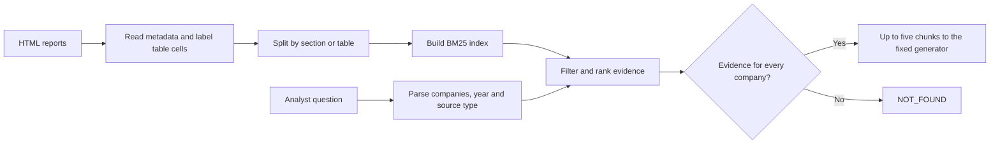

# FTEC5660 Homework 4

Chen Youxin · 1155274414

This is a report retrieval system for the course's fictional company library. It builds its index from the supplied HTML on each run and passes the selected passages to the course generator.

## Run on the public set

I tested on Windows with CPython 3.12.14. Run the commands from the repository root with your own DeepSeek API key in a local `.env` file (`DEEPSEEK_API_KEY=your_key_here`).

```sh
python -m venv .venv
```

Activate with `.venv\Scripts\Activate.ps1` in Windows PowerShell or `source .venv/bin/activate` on Linux/macOS. Then run:

```sh
python -m pip install -r requirements.txt
python hw4.py --data-folder public_test --output results.csv
```

For example, to repeat the baseline and final configuration, run:

```sh
python run_ablation.py --variant B0 --data-folder public_test --output results_B0.csv
python run_ablation.py --variant V6 --data-folder public_test --output results_V6.csv
```

The available variants are B0 and V1 through V6. The public data and fixed runner come from the [course starter](https://github.com/hz0567/FTEC5660-HW4/tree/89141195ffc63004dec6e8cac1d6ad19e7c862a4). A fresh run makes new generator calls. The requested model name in the course runner is `deepseek-v4-flash`, which the provider [routes to V4.1 Flash](https://api-docs.deepseek.com/en/).

## Homework 4 solution



I originally treated every passage as a block of searchable words. That kept the vocabulary but lost the link between a figure and its year. In the final version, each table row carries its column labels and the caption supplies the unit. I split prose by heading and keep each table separate, with chunks capped at 1,500 characters. The retriever reads the company, requested year and source type from the question, then filters the BM25 candidate pool. It can use the previous-year column of a later annual report when that column contains the requested year. It ranks passages with a matching row or disclosure ahead of passages with similar words. For comparisons, it reserves a place for each company. If a company has no matching source or passage, retrieval returns an empty list. All of these steps run without model calls. The provided generator receives the original chunks and writes the answer.

### Public ablation

I ran each configuration once on the same 40 documents and 60 questions, with the same generator. Recall counts a hit only when the retrieved passages cover every required fact in the course answer key. The recall denominator is 46 answerable questions. The rejection denominator is 14 unanswerable questions. B0 uses plain BeautifulSoup text and the recursive splitter with 1,500 characters and 150 characters of overlap. All stages use BM25 with lowercase whitespace tokens. The table shows the complete set of measured changes.

| Run | Change from the previous run | Recall@5 | Answerable kept | Unanswerable rejected | Answers correct | Generator calls |
| --- | --- | ---: | ---: | ---: | ---: | ---: |
| B0 | Plain text, recursive splitting and corpus-wide BM25 top five | 18/46 | 46/46 | 0/14 | 28/60 | 60 |
| V1 | Label each table value with its row and column | 16/46 | 46/46 | 0/14 | 30/60 | 60 |
| V2 | Split on sections and tables | 13/46 | 46/46 | 0/14 | 26/60 | 60 |
| V3 | Parse the question and scope the candidate pool by metadata | 36/46 | 46/46 | 0/14 | 51/60 | 60 |
| V4 | Rank chunks with direct evidence ahead of other lexical matches | 46/46 | 46/46 | 0/14 | 60/60 | 60 |
| V5 | Reserve one result for each named company in comparisons | 46/46 | 46/46 | 0/14 | 60/60 | 60 |
| V6 | Require evidence for every company before returning chunks | 46/46 | 46/46 | 14/14 | 60/60 | 46 |

The per-question runner outputs are in [`evaluation/`](evaluation/). `results.csv` is the final V6 run. The V6 runner also gave full credit on all 12 sampled tables and passed all 40 document checks. Each field was correct on all 60 parsed queries.

### What changed and why

**V1 and V2.** Adding column labels improved the answer count by two, even though two fewer questions had complete evidence. For q026, the sources listed in the CSV stayed the same, but V1 retrieved a passage with the 2023 long-term borrowing figure. It answered `446.9`, where B0 had answered `NOT_FOUND`. Section splitting in V2 increased the number of chunks from 267 to 845. Searching across all companies with the same five slots became less effective. Smaller chunks made the passages easier to read, but they could still come from the wrong company or section.

**V3 and V4.** Scoping the search produced the largest jump in recall, from 13 to 36 hits. For q002, V2 answered `1600` for FY2025 revenue, consistent with a rounded USD 1.6 billion mention. V3 reached the passage with the exact USD 1,574.7 million figure. For q003, V3 and V4 list the same four source files, but only V4 included the necessary evidence for both companies. The difference was which passages were selected inside those files. Moving the matching employee rows up the ranking fixed that miss.

**V5 and V6.** Reserving a slot for each company did not improve the public score because V4 already found both facts on every comparison. I kept the rule because it makes the coverage requirement explicit when one company's documents have many close matches. V5's generator already answered all 14 unanswerable questions correctly, even though retrieval sent passages for them. In V6, retrieval rejected those questions first. That saved 14 generator calls, and the recorded generator input fell from 86,212 to 44,141 tokens. Output accuracy stayed at 60/60 in these runs.

The public set was used for development and evaluation. The perfect public score measures performance on these questions. The scope rules depend on the report layouts and the names recovered from them. An unfamiliar paraphrase or an answer that is only implied across several paragraphs can still be missed by the evidence check.

## Homework 4 reflection

[When everyone has an AI agent](reflection.md)
